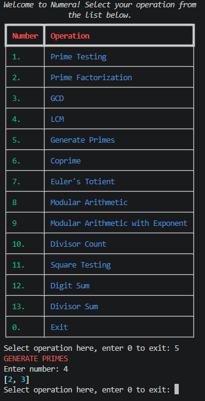

# numera
A Python-based command-line application for performing various number-theoretic operations.



## 🌟 Features

- Primality testing and prime factorization
- Coprimality testing
- Modulo operation
- GCD & LCM
- Prime Generation using the Sieve of Eratosthenes
- Euler's Totient Function
- Perfect Square Testing
- Divisor Counting and Divisor Sum
- Digit Sum

## 🚀 Getting Started

### Prerequisites

- Python 3.14+
- Libraries: rich

### Installation

1. Clone the repository:

```bash
git clone [repository-url]
```

2. Navigate to the project directory:

```bash
cd numera
```

3. Create and activate a virtual environment (optional but recommended).

4. Install dependencies:

```bash
pip install -r requirements.txt
```

## 💻 Usage

To use Numera, simply run "python project.py". A table (generated from Rich) should show, and you simply use the CLI to pick your option.

### Example Session

```text
# Example 1
Welcome to Numera! Select your operation from
               the list below.               
┏━━━━━━━━┳━━━━━━━━━━━━━━━━━━━━━━━━━━━━━━━━━━┓
┃ Number ┃ Operation                        ┃
┡━━━━━━━━╇━━━━━━━━━━━━━━━━━━━━━━━━━━━━━━━━━━┩
│ 1.     │ Prime Testing                    │
├────────┼──────────────────────────────────┤
│ 2.     │ Prime Factorization              │
├────────┼──────────────────────────────────┤
│ 3.     │ GCD                              │
├────────┼──────────────────────────────────┤
│ 4.     │ LCM                              │
├────────┼──────────────────────────────────┤
│ 5.     │ Generate Primes                  │
├────────┼──────────────────────────────────┤
│ 6.     │ Coprime                          │
├────────┼──────────────────────────────────┤
│ 7.     │ Euler's Totient                  │
├────────┼──────────────────────────────────┤
│ 8      │ Modular Arithmetic               │
├────────┼──────────────────────────────────┤
│ 9      │ Modular Arithmetic with Exponent │
├────────┼──────────────────────────────────┤
│ 10.    │ Divisor Count                    │
├────────┼──────────────────────────────────┤
│ 11.    │ Square Testing                   │
├────────┼──────────────────────────────────┤
│ 12.    │ Digit Sum                        │
├────────┼──────────────────────────────────┤
│ 13.    │ Divisor Sum                      │
├────────┼──────────────────────────────────┤
│ 0.     │ Exit                             │
└────────┴──────────────────────────────────┘
Select operation here, enter 0 to exit: 

# Example 2
Select operation here, enter 0 to exit: 5
GENERATE PRIMES
Enter number: 4
[2, 3]
Select operation here, enter 0 to exit: 
```

## 🧪 Testing

To test Numera, run the following command and ensure all unit tests pass.

```bash
pytest test_project.py
```

## 🛠️ Technologies

- **Languages**: Python
- **Libraries**: rich
- **Development Packages**: ruff, pytest

## 📄 License

This project is licensed under the MIT License. See the [LICENSE](LICENSE) file for details.